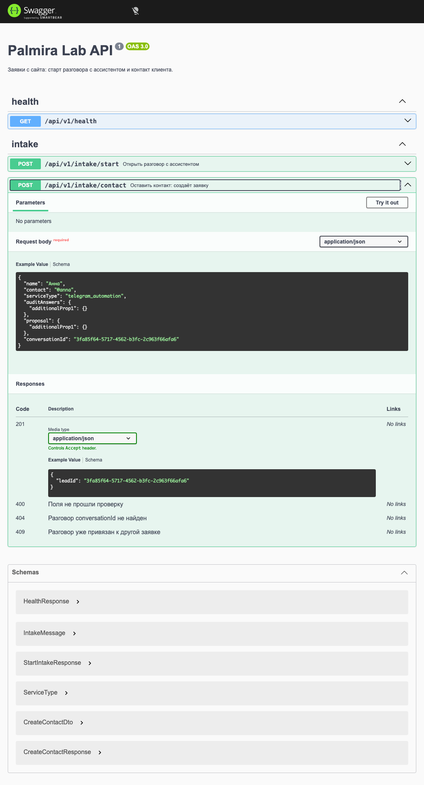

# Palmira Lab

[](https://github.com/palmiralab/palmira-lab/actions/workflows/ci.yml)

Сайт студии автоматизации и ИИ-решений для малого бизнеса: сайты и лендинги, Telegram-боты, автоматизация рутины, ИИ-консультации. Посетитель описывает задачу в чате, ИИ-помощник задаёт 2–4 уточняющих вопроса и собирает коммерческое предложение (КП) либо направляет на бесплатный ИИ-аудит. Заявка попадает в базу, а владельцу приходит уведомление в Telegram и на почту.

В проекте есть всё: фронтенд, API, база, интеграция с LLM, уведомления, упаковка в Docker и выкладка на боевой сервер.

## Что внутри

- **Чат с ИИ-помощником.** Состояния чата описаны объединённым типом (ожидание, ответ, сбор контакта, ошибка, подтверждение перезапуска), повторы при сбоях, индикатор «думает», поле ввода подстраивается под клавиатуру на телефоне.
- **Бесплатный ИИ-аудит.** Пошаговая анкета из 7 вопросов (состояние на `useReducer`, логика в тестируемых чистых функциях), один компонент работает и на отдельной странице, и внутри чата.
- **Каталог услуг, 7 кейсов, раздел «Демо»** (калькулятор рутины, быстрые заметки, визитка, макет заявки), страница политики обработки данных (152-ФЗ), тёмная тема без «мигания», адаптивная вёрстка.
- **API приёма заявок** на NestJS с валидацией, транзакциями, защитой формы и уведомлениями.

## Архитектура

```
Браузер ──► nginx (HTTPS, прокси) ──► web  (Next.js, :3000)
                                        │   ├─ /api/proposal ──► LLM (GigaChat)
                                        │   └─ /api/contact  ──┐
                                        ▼                       │ только с сервера Next,
                                    страницы                    │ из браузера API недоступен
                                                                ▼
                                                     api  (NestJS, :3100) ──► PostgreSQL
                                                                │
                                                                └─► Telegram Bot API + SMTP (в фоне)
```

Браузер ходит только в Next.js. В боевой выкладке API и база наружу не опубликованы: общаться с ними может только сервер Next. Ключи ИИ-провайдера тоже живут на стороне сервера.

## Стек

| Слой | Технологии |
|---|---|
| Сайт (`apps/web`) | Next.js 16 (App Router), React 19, TypeScript, Tailwind CSS 4, Vitest |
| API (`apps/api`) | NestJS 12, TypeScript, Prisma 7, PostgreSQL 17, class-validator, zod (переменные окружения), Vitest и Supertest, oxlint |
| ИИ | GigaChat (боевой провайдер), адаптер DeepSeek за общим интерфейсом `ProposalGenerationProvider` |
| Уведомления | Telegram Bot API, SMTP (`nodemailer`) |
| Инфраструктура | Docker и Docker Compose (multi-stage образы), nginx как reverse proxy, Let's Encrypt |

## Ключевые инженерные решения

Коротко, что сделано и почему. Подробнее по датам — в [`JOURNAL.md`](JOURNAL.md).

**Заявка и уведомление.** Заявка и привязка к ней разговора создаются в одной транзакции, а уведомление уходит только после коммита. Отправка идёт в фоне, поэтому посетитель получает ответ сразу, а сбой Telegram не ломает приём заявки. Telegram и почта работают как независимые каналы с повторами: канал с нашего сервера до Telegram оказался нестабильным, почта выступает дублем.

**Гонки и идемпотентность.** Привязка разговора к заявке делается условным `updateMany` (`leadId: null`), лимит повторов на один контакт защищён `pg_advisory_xact_lock` против гонки «проверил, потом вставил», повторная отправка получает тот же успешный ответ, а не ошибку. Тест, который не доказывал блокировку, был честно удалён.

**Структурированный ответ LLM.** Режимы `json_schema`, `json_object` и «просто текст» сравнивались на живых моделях. Строгая схема у GigaChat оказалась нестабильной (модель Lite возвращала пустой `content`, Max портила около трети ответов), поэтому боевой режим: текстовый JSON и собственная проверка формы на стороне сайта, до трёх попыток, снятие markdown-обёртки, понятный ответ при срабатывании фильтра тем. Строгая реализация оставлена в коде как справочная.

**Несколько LLM-провайдеров за одним интерфейсом.** Общие промпты и общая проверка ответа, адаптеры взаимозаменяемы на уровне кода. Смена провайдера требует обновить политику обработки данных (см. ниже), это зафиксировано в правилах проекта.

**Защита публичной формы.** Honeypot, лимит запросов по IP, не более трёх заявок на контакт и услугу в сутки с нормализацией контакта, лимиты размеров на каждом слое. Сайт берёт первый адрес из `X-Forwarded-For`, а nginx перезаписывает заголовок, чтобы клиент не мог подделать IP.

**Политика данных и код.** Страница `/privacy` содержит обещания посетителям. Правило в [`CLAUDE.md`](CLAUDE.md): любое изменение провайдера ИИ, формы, уведомлений, хостинга или внешних скриптов обновляет страницу в том же изменении.

**Конфигурация.** Переменные окружения валидируются через zod при старте, приложение падает сразу и понятно, значения секретов не попадают в тексты ошибок и логи.

## Тесты

279 тестов: сайт 153, API unit 83, API e2e 43 (на настоящей PostgreSQL). Тесты пишутся вперёд, e2e идут через реальную базу, а не мок.

```bash
cd apps/web && npm test            # сайт
cd apps/api && npm test            # API unit
cd apps/api && npm run test:e2e    # API e2e, нужна запущенная база и DATABASE_URL
```

Нужен Node 24: на Node 20 падают `vitest` и `oxlint`.

Те же проверки идут в GitHub Actions на каждый PR и push в `main` ([`.github/workflows/ci.yml`](.github/workflows/ci.yml)): три параллельных job: API (линтер, unit, сборка), сайт (линтер, unit, сборка с проверкой типов и пререндера страниц) и API e2e на PostgreSQL 17 с боевыми миграциями на пустой базе. Секретов в CI нет, права токена только на чтение.

## Как запустить локально

Требуется Node 24 (версия зафиксирована в `.nvmrc`: `nvm use`) и Docker. Именно 24: на Node 20 не запускаются `vitest` и `oxlint`.

В `certs/` лежит корневой сертификат Минцифры: API GigaChat (Сбер) подписан им, а в Node его нет в списке доверенных. Файл подключается переменной `NODE_EXTRA_CA_CERTS` (в скриптах `apps/web/package.json` и в `Dockerfile`), системное хранилище не меняется.

```bash
# 1. База
cp .env.example .env                  # задайте пароль в POSTGRES_PASSWORD
docker compose up -d postgres

# 2. API (порт 3100)
cd apps/api
cp .env.example .env                  # пароль в DATABASE_URL должен совпасть с корневым .env
npm ci
npm run prisma:generate
npm run db:migrate
npm run start:dev

# 3. Сайт (порт 3000), в другом терминале
cd apps/web
cp .env.example .env
npm ci
npm run dev
```

Если порт `5432` у вас уже занят, поменяйте `POSTGRES_PORT` в корневом `.env` и тот же порт в `DATABASE_URL` из `apps/api/.env`. Предупреждения `npm warn allow-scripts` при `npm ci` ожидаемы и на запуск не влияют.

Чат-ассистенту нужен собственный ключ GigaChat (`GIGACHAT_AUTH_KEY` в `apps/web/.env`, кабинет [developers.sber.ru](https://developers.sber.ru/)). Без него чат отвечает ошибкой, а остальные страницы и приём заявок работают. Telegram и почта для уведомлений необязательны и включаются переменными из `apps/api/.env.example`.

## Деплой

`docker-compose.prod.yml` описывает боевую выкладку: PostgreSQL (порт наружу не публикуется), одноразовый контейнер миграций, API и сайт. Образы multi-stage, API и сайт работают не от root и имеют `HEALTHCHECK`, API стартует только после успешной миграции, сайт ждёт здоровый API. Наружу сервисы отдаёт nginx. Выкладка на VPS (Docker, nginx, HTTPS, сертификаты) выполнена автором вместе с Claude Code, шаг за шагом, с разбором каждого шага.

## Чего пока нет

Деплой ручной, нет автоочистки заявок по сроку хранения (на странице `/privacy` обещано 12 месяцев, пока чистка ручная), нет мониторинга и авторизованной админки для заявок, нагрузочных тестов тоже нет.

## Документация

- **API:** [`docs/openapi.json`](docs/openapi.json) (схема OpenAPI 3) и страница Swagger UI, которую API отдаёт по `/api/v1/docs`, если задать `SWAGGER_ENABLED=true` в `apps/api/.env`. На проде страница выключена: API наружу не публикуется. Схема собирается из декораторов в коде, а файл в репозитории обновляется командой `npm run openapi` (в `apps/api`); тест падает, если файл устарел.

  

- [`docs/database.md`](docs/database.md): ER-диаграмма базы (Mermaid), обновляется в одном коммите с каждой миграцией.
- [`CLAUDE.md`](CLAUDE.md): правила проекта для агента-помощника и для людей.
- [`JOURNAL.md`](JOURNAL.md): публичный журнал: что сделано и когда.
