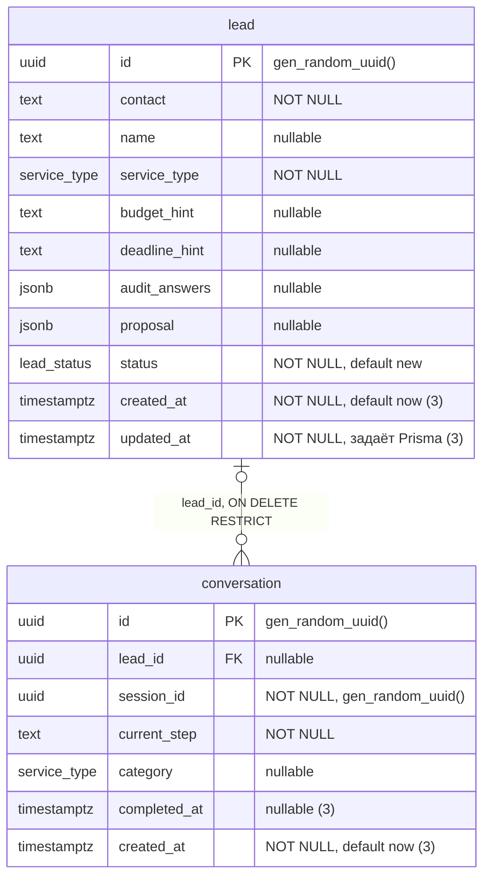
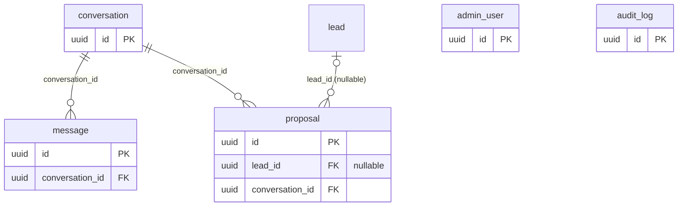

# База данных: ER-схема

PostgreSQL 17 (контейнер из `docker-compose.yml`), схема ведётся через
Prisma 7: источник правды `apps/api/prisma/schema.prisma`, изменения только
миграциями (`apps/api/prisma/migrations/`). Этот файл обновляется вместе с
каждой миграцией.

Имена: в базе `snake_case`, в TypeScript `camelCase` (`@map`).

## Реализовано

### `lead`: потенциальный клиент

Лид: человек, который проявил интерес и оставил способ связаться. Появляется
в конце разговора, когда посетитель оставил контакт.

| Колонка | Тип | Null | По умолчанию | Примечание |
|---|---|---|---|---|
| `id` | `uuid` | нет | `gen_random_uuid()` | PK |
| `contact` | `text` | нет | | как связаться |
| `name` | `text` | да | | |
| `service_type` | `service_type` | нет | | enum, см. ниже |
| `budget_hint` | `text` | да | | пожелание клиента, свободный текст |
| `deadline_hint` | `text` | да | | пожелание клиента, свободный текст |
| `audit_answers` | `jsonb` | да | | ответы анкеты бесплатного аудита целиком; пусто, пока человек её не проходил. JSON, а не отдельная таблица: набор вопросов фиксирован, ответы читаются вместе, поиска по отдельным нет. Если появятся несколько аудитов на лида или версии анкеты, переносим в таблицу |
| `proposal` | `jsonb` | да | | КП, которое видел клиент на момент заявки, снимком целиком; пусто, если заявка пришла без КП (аудит, manual_review). JSON по той же причине, что и `audit_answers`: читается целиком, форма КП может меняться |
| `status` | `lead_status` | нет | `'new'` | enum, см. ниже |
| `created_at` | `timestamptz(3)` | нет | `CURRENT_TIMESTAMP` | |
| `updated_at` | `timestamptz(3)` | нет | нет | заполняет Prisma при записи; сырой SQL должен задавать сам |

Индексы: `lead_pkey` (PK по `id`); `lead_status_created_at_idx` по
`(status, created_at DESC)`: список и фильтрация лидов.

### `conversation`: чат-сессия посетителя

Разговор начинается раньше, чем появляется лид, поэтому `lead_id` пуст, пока
посетитель не оставил контакт.

| Колонка | Тип | Null | По умолчанию | Примечание |
|---|---|---|---|---|
| `id` | `uuid` | нет | `gen_random_uuid()` | PK; клиент присылает его как `conversationId` |
| `lead_id` | `uuid` | да | | FK → `lead(id)`, `ON DELETE RESTRICT ON UPDATE CASCADE` |
| `session_id` | `uuid` | нет | `gen_random_uuid()` | идентификатор сессии посетителя (продолжение чата), отдельный от `id` |
| `current_step` | `text` | нет | нет | шаг сценария; допустимые значения пока в коде, в enum переведём, когда сценарий устоится |
| `category` | `service_type` | да | | тип услуги; пусто, пока сценарий не определил |
| `completed_at` | `timestamptz(3)` | да | | пусто, пока разговор не завершён |
| `created_at` | `timestamptz(3)` | нет | `CURRENT_TIMESTAMP` | |

Индексы: `conversation_pkey` (PK по `id`); `conversation_session_id_idx` по
`session_id`: продолжение пользовательской сессии. Индекса на `lead_id`
нет намеренно (план §10.2: без индексов «на всякий случай», вернуться после
`EXPLAIN ANALYZE` на реальных данных).

`ON DELETE RESTRICT`: лида с разговорами удалить нельзя, история остаётся для
аналитики. Если понадобится «удалить данные по запросу клиента», сначала
придётся разобраться с его разговорами (открытый вопрос).

### Enum-типы

| Тип | Значения |
|---|---|
| `service_type` | `telegram_automation`, `website_landing`, `content_automation`, `ai_consultation`, `manual_review` |
| `lead_status` | `new`, `contacted`, `qualified`, `proposal`, `won`, `lost`, `manual_review` |

Жизненный цикл статуса: `new → contacted → qualified → proposal → won`,
ответвление `lost`; `manual_review` для непонятных или нестандартных
запросов.

## План (ещё не в базе)

Связи между сущностями из плана (`session-plan.md` §10.1, поля и типы
уточним при создании каждой таблицы). Показаны только ключи; `conversation`
уже реализована (см. выше) и присутствует как точка привязки.

`admin_user` и `audit_log` без внешних ключей на другие таблицы (в
`audit_log` ссылка на сущность полиморфная: `entity_type` + `entity_id`).
Тип идентификаторов в этих таблицах (`uuid`) пока предположение по аналогии с
`lead`.
